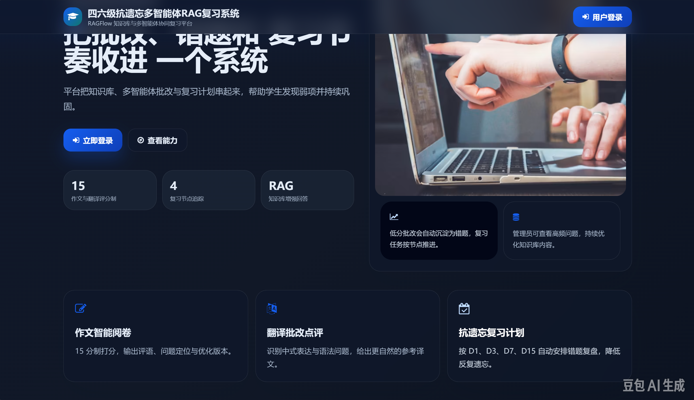
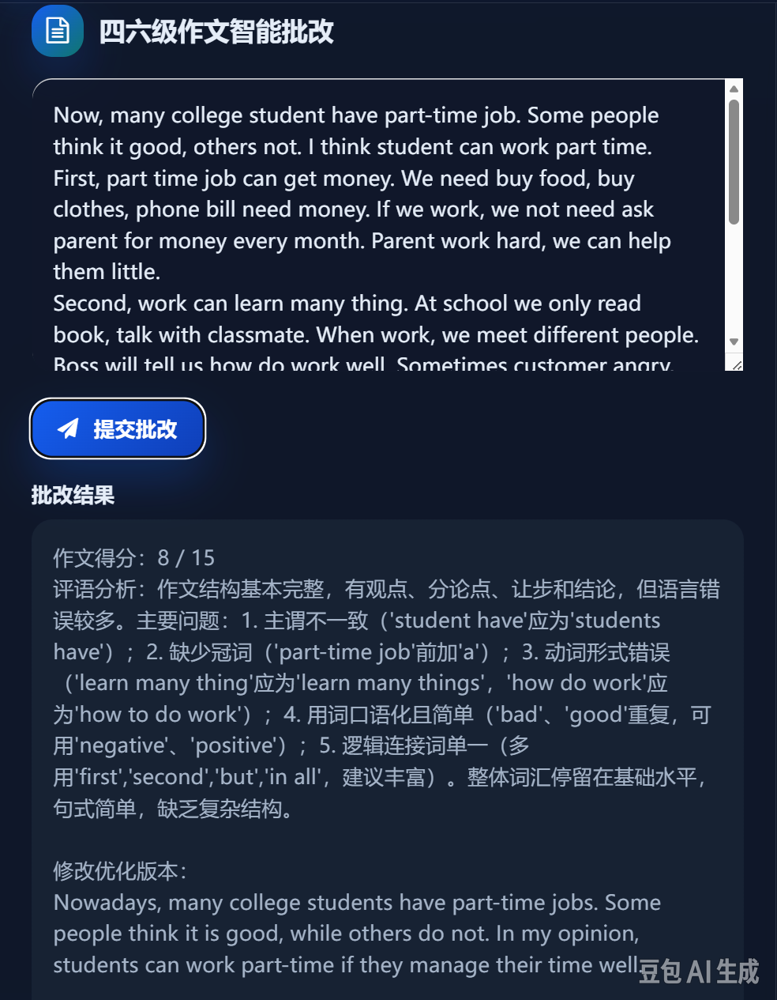
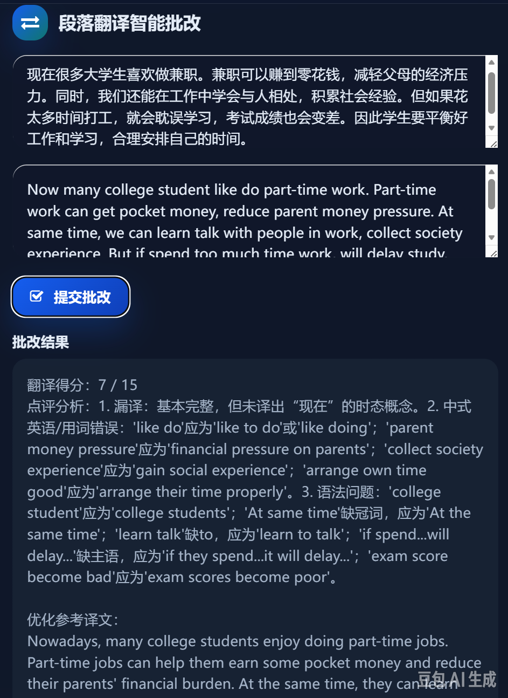
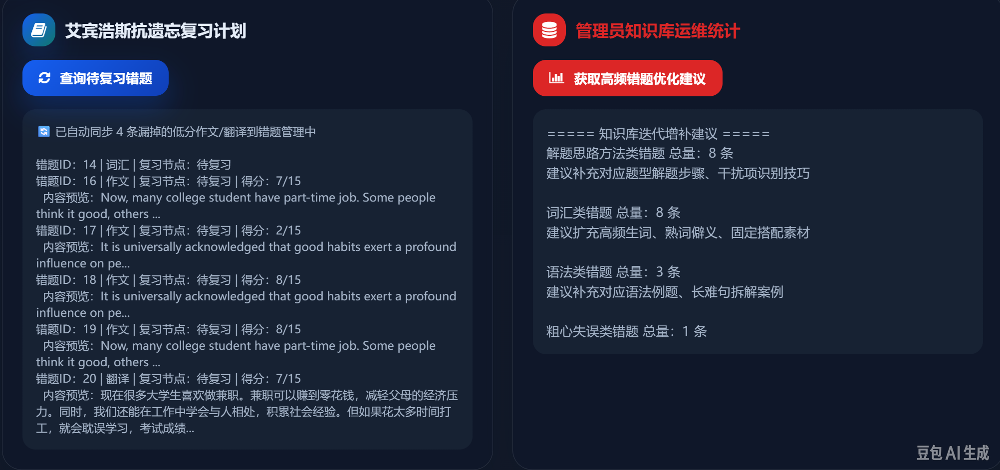
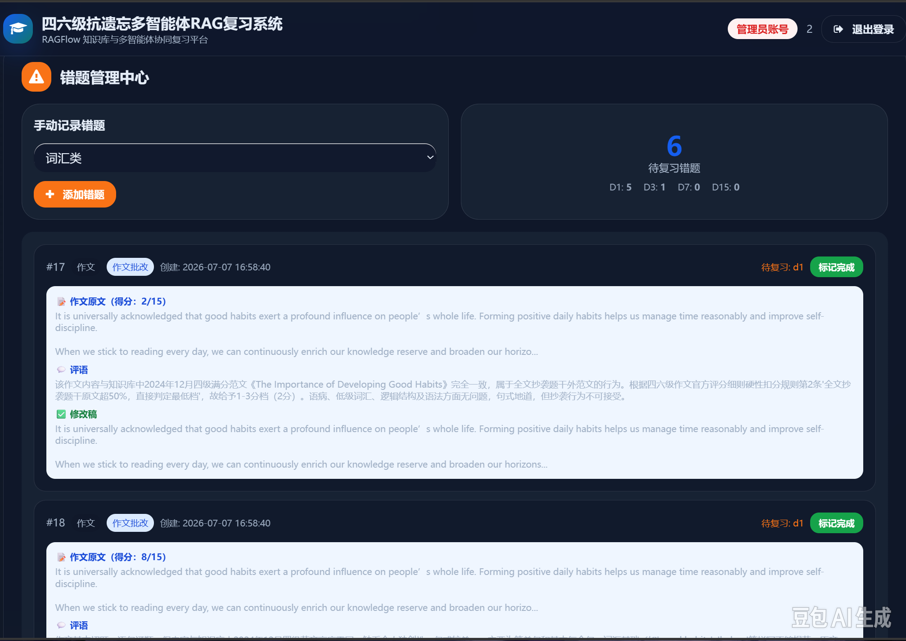
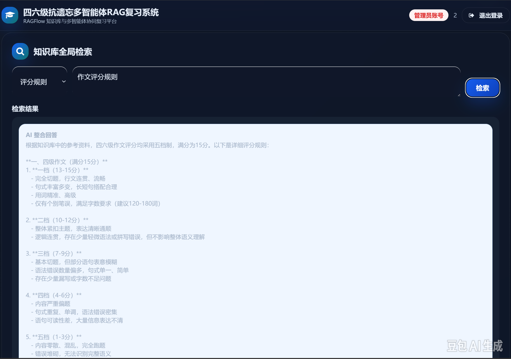

# 大学英语四六级抗遗忘复习系统

**College English CET-4/6 Anti-Forgetting Review System**

基于多智能体 RAG 架构的四六级备考平台：以 RAGFlow 知识库 + LangGraph 多智能体协同 + 艾宾浩斯遗忘曲线为核心，提供作文智能批改、翻译智能评分、错题管理、科学复习计划与知识库全局检索等能力，实现「个性化批改 + 科学抗遗忘 + 精准提分」。

---

## 功能特性

| 模块 | 说明 |
| --- | --- |
| 用户登录与角色鉴权 | 学生 / 管理员双角色路由 |
| 作文智能批改 | 15 分制打分 + 逐条点评（语病 / 词汇 / 逻辑 / 语法）+ 润色修改稿 |
| 翻译智能评分 | 中式英语 / 漏译 / 用词 / 语法识别 + 地道优化参考译文 |
| 艾宾浩斯复习计划 | D1 → D3 → D7 → D15 四轮自动循环，完成标记 + 进度统计 |
| 错题管理中心 | 手动添加 + 低分自动沉淀 + 逐阶段完成按钮 + 分类统计 |
| 知识库全局检索 | 类别筛选 → RAG 检索 → AI 整合回答优先展示 + 原始检索结果 |
| 管理员统计面板 | 高频错题分析 → 知识库迭代增补建议 |
| OCR 拍照识题 | EasyOCR + LLM 视觉识别双引擎回退 |

## 系统架构

```text
┌────────────────────────────────────────────────────────────┐
│ 前端层  Tailwind CSS + 原生 JavaScript (SPA)              │
│  登录 / 作文批改 / 翻译评分 / 错题管理 / 知识检索 / OCR识题  │
└──────────────────────────┬─────────────────────────────────┘
                           │ RESTful API
┌──────────────────────────▼─────────────────────────────────┐
│ 后端层  Python FastAPI (port 8000)                         │
│  登录鉴权 · 业务提交 · 复习查询 · 错题 CRUD · 健康检查       │
└──────────────────────────┬─────────────────────────────────┘
                           │
┌──────────────────────────▼─────────────────────────────────┐
│ 智能体编排层  LangGraph StateGraph（多节点协同）            │
│  Dispatcher → RAG检索 → Judge评分 / Synthesize整合 → 结果   │
└──────────────────────────┬─────────────────────────────────┘
                           │
┌──────────────────────────▼─────────────────────────────────┐
│ 知识检索层  RAGFlow (Docker, port 9380)                    │
│  统一知识库 · ThreadPoolExecutor 并行检索（避免串行超时）    │
└──────────────────────────┬─────────────────────────────────┘
                           │
┌──────────────────────────▼─────────────────────────────────┐
│ 数据层  MySQL 8.0 (port 3307)                              │
│  user / writing_submit / trans_submit / error_record       │
└────────────────────────────────────────────────────────────┘
```

### LangGraph 多智能体编排

- **Dispatcher**：任务分发与路由判断
- **RAG Agent**：知识库检索（并行查询）
- **Judge Agent**：作文 / 翻译智能评分
- **Synthesize**：检索结果 AI 整合回答
- **Review Agent**：艾宾浩斯复习计划
- **KB Agent**：高频错题统计建议

路由规则：

- 写作 / 翻译任务：`Dispatch → RAG → Judge`
- 知识检索：`Dispatch → RAG → Synthesize`
- 复习：`Dispatch → Review`
- 管理：`Dispatch → KB`

## 技术栈

| 技术 | 用途 |
| --- | --- |
| Python 3.12 | 后端主语言 |
| FastAPI + LangGraph + pymysql | Web 框架 + 多智能体编排 + 数据库访问 |
| LangGraph (StateGraph) | 多智能体编排框架，条件路由 · 6 节点协同 |
| RAGFlow | RAG 知识库引擎，Docker 部署 · OpenAI 兼容 API · 统一知识库 |
| DeepSeek-V4 | 大语言模型，经 RAGFlow 代理调用 · 90s 超时控制 |
| MySQL 8.0 | 关系型数据库，4 张业务表 · 艾宾浩斯复习节点追踪 |
| Tailwind CSS | 前端框架，响应式 SPA · 暗色模式自适应 · Font Awesome 图标 |
| ThreadPoolExecutor(4) | 并行检索优化，作文 / 翻译双检索并行 |
| EasyOCR | 光学字符识别，拍照识题 → 中英文 OCR → LLM 视觉回退 |

## 快速开始

> 以下命令基于项目实际部署方式整理，请按你的目录结构与 `.env` 实际配置微调。

### 环境依赖

- Docker（部署 RAGFlow）
- MySQL 8.0
- Python 3.12
- DeepSeek API Key

### 1. 部署 RAGFlow 知识库

### 1. 部署 RAGFlow 知识库

部署配置参考本地环境。RAGFlow v0.17（默认端口 9380）通过 Docker 部署，docker-compose.yml 参考 RAGFlow 官方仓库配置，本仓库未包含部署文件。

- 创建知识库，导入四六级资料数据集（考纲词汇表、高分范文、评分标准、翻译真题与参考译文、语法长难句、解题技巧、常见错误归纳）
- 知识库切片解析后向量化（Embedding 模型：`BAAI/bge-m3`）

### 2. 初始化数据库

```sql
-- 在 MySQL 8.0（端口 3307）中创建 4 张业务表
-- user / writing_submit / trans_submit / error_record
```

### 3. 配置后端环境变量

在 `backend/` 下创建 `.env`：

```ini
MYSQL_HOST=localhost
MYSQL_PORT=3307
MYSQL_USER=root
MYSQL_PASSWORD=your_password
MYSQL_DB=cet_review

RAGFLOW_BASE_URL=http://localhost:9380
RAGFLOW_API_KEY=your_ragflow_api_key
RAGFLOW_KB_ID=your_knowledge_base_id
RAGFLOW_CHAT_ID_LLM=your_no_kb_chat_id

DEEPSEEK_API_KEY=your_deepseek_api_key
```

### 4. 启动后端

部署配置参考本地环境。后端依赖见代码 import，按 FastAPI + pymysql + langgraph + requests 等常规依赖自行安装；启动命令：

```bash
cd backend
uvicorn main:app --host 0.0.0.0 --port 8000
```

### 5. 启动前端

```bash
cd frontend
python -m http.server 8080
```

浏览器访问 `http://localhost:8080` 即可使用。

## 数据库表设计

| 表名 | 说明 |
| --- | --- |
| `user` | 用户信息（学生 / 管理员角色） |
| `writing_submit` | 作文提交与批改记录 |
| `trans_submit` | 翻译提交与评分记录 |
| `error_record` | 错题记录（含艾宾浩斯复习节点状态） |

## 核心算法：艾宾浩斯抗遗忘复习

错题创建后自动进入四轮复习循环，按错题首次记录时间推进节点：

```text
Day 0 错题创建（低分自动触发 / 手动添加）
  → Day 1  第 1 轮复习（首次回顾，识别知识盲区）
  → Day 3  第 2 轮复习（间隔 2 天巩固，强化记忆痕迹）
  → Day 7  第 3 轮复习（间隔 4 天深化，长时记忆转化）
  → Day 15 第 4 轮复习（间隔 8 天收尾，完成抗遗忘周期）
```

核心节点判断逻辑：

```python
if not review_d1 and now >= first_wrong + timedelta(days=1):
    return '第1轮(1天后)复盘'
if review_d1 and not review_d3 and now >= first_wrong + timedelta(days=3):
    return '第2轮(3天后)复盘'
if review_d3 and not review_d7 and now >= first_wrong + timedelta(days=7):
    return '第3轮(7天后)复盘'
if review_d7 and not review_d15 and now >= first_wrong + timedelta(days=15):
    return '第4轮(15天后)复盘'
return None   # 未到时间或已完成
```

- 作文得分 ≤ 9 分自动创建错题，纳入复习计划闭环
- 完成 D15 后自动归档

## 检索评测与消融实验

> 生产系统基于 RAGFlow 统一知识库引擎；为量化检索链路各模块的独立增益，`eval/` 目录下搭建了一套独立的本地检索评测管线（TF-IDF + bge-m3 + RRF），与生产链路解耦，可单独复现消融实验。

### 评测集

- **规模**：214 题，按题型分层——词汇 120 / 翻译 66 / 写作 28
- **来源**：取自知识库真实文档，为开卷检索评测
- **指标**：
  - `doc@5`：Top-5 文档级召回，按来源文档名匹配
  - `kw@5`：答案关键词命中率，按关键词大小写不敏感匹配

### 基线配置

| 维度 | 配置 |
| --- | --- |
| 后端 | TF-IDF 词法检索（char_wb，2-4 元字符 n-gram，余弦相似度） |
| 切块 | naive 切块：按空行分段，合并至 800 字符，overlap 100 |
| 查询改写 | 无（query 原样） |

基线结果：**doc@5 = 31.8%，kw@5 = 42.1%**

### 消融实验

| 模块 | 增益 | 说明 |
| --- | --- | --- |
| 词条级切块（替代 naive） | +16.8pp | 按词条边界切分，避免定义被切断 |
| 查询改写 | +1.4pp | 低质 query 改写后再检索 |
| bge-m3 密集 / TF-IDF 词法 RRF 双路融合 | +5.6pp | 密集与词法互补，RRF 融合排序 |

### 全链路最终结果

| 指标 | 基线 | 全链路 | 提升 |
| --- | --- | --- | --- |
| doc@5 | 31.8% | **96.7%** | +64.9pp |
| kw@5 | 42.1% | **95.8%**（205/214） | +53.7pp |

分题型：词汇子集 120/120 全命中，翻译子集 66/66 全命中。

**消融结论**：主增益来自切块策略与双路融合，而非更换更大参数模型，验证检索工程对 RAG 效果的主导作用。

### 复现

```bash
cd eval
# 一键跑三组消融并打印增益表
python run_ablations.py
```

相关文件：
- `eval/local_retrieval_eval.py`：TF-IDF / bge-m3 / hybrid 三后端 + naive/structured 切块 + none/basic 改写
- `eval/run_ablations.py`：一键复现三组消融（RRF 融合、词条切块、查询改写）
- `eval/build_eval_set_200.py` + `eval/eval_set_200.json`：214 题评测集生成脚本与数据
- `eval/eval_lib.py`：打分逻辑

## 关键技术难点与解决方案

| 难点 | 解决方案 |
| --- | --- |
| LLM 调用超时（带 KB 检索时长 prompt 超过 90s） | 创建 no-KB Chat Assistant（`RAGFLOW_CHAT_ID_LLM`），上游完成检索后，下游纯 LLM 调用避免冗余 KB 检索 |
| Prompt Token 爆炸（全量 JSON 检索结果直接喂给 LLM） | `_format_rag_context_for_llm()` 截断策略：最多 5 chunks × 400 chars，总上下文 ≤ 2500 chars |
| 串行检索超时叠加（writing/trans 需两次检索） | `ThreadPoolExecutor` 并行检索，两个请求同时发出，`as_completed` 收集结果，总耗时 = 最慢的一次 |
| EasyOCR 环境兼容问题（numpy 版本不兼容导致崩溃） | `try/except BaseException` 守护初始化 + 永久禁用标记 + LLM 视觉识别回退 |
| LLM JSON 解析不稳定 | `_loads_llm_json()` 多层容错：去除 ```json``` 包裹 → 正则提取 `{ }` → 兼容 RAGFlow 原生 / OpenAI 两种格式 |

## 项目截图

### 首页与登录



### 作文智能批改



### 翻译智能评分



### 艾宾浩斯复习计划



### 错题管理中心



### 知识库全局检索



## 团队

| 成员 | 角色 | 职责 |
| --- | --- | --- |
| 袁豪（组长） | 后端 / 架构 | 项目架构设计、LangGraph 多智能体编排、核心代码开发、检索评测与消融实验 |
| 谭桥峰 | 知识库 | RAGFlow 知识库搭建、数据导入与管理、API 封装 |
| 冉校川 | 前端 | 前端页面开发（Tailwind CSS + 原生 JS）、交互设计 |
| 詹子轩 | 算法 / 数据库 | 数据库设计、艾宾浩斯复习算法、测试与优化前端代码 |
| 傅海洋 | 测试 / 数据 | 数据清洗、系统测试、演示录制、答辩材料准备 |

## License

MIT
